


[About](#about) &nbsp;·&nbsp; [Projects](#projects) &nbsp;·&nbsp; [Skills](#skills) &nbsp;·&nbsp; [Activity](#activity) &nbsp;·&nbsp; [Connect](#connect)



<a href="https://sizanbd.vercel.app"></a>
<a href="https://mint-homes-delta.vercel.app"></a>
<a href="https://lucas-heffner.vercel.app"></a>
<a href="https://cat-the-carp.vercel.app"></a>
<a href="https://start-two-nu.vercel.app"></a>
<a href="https://double-good.vercel.app"></a>

Source:
<a href="https://github.com/tumit75/sizanbd">sizanbd</a> ·
<a href="https://github.com/tumit75/mint-homes">mint-homes</a> ·
<a href="https://github.com/tumit75/lucas-heffner">lucas-heffner</a> ·
<a href="https://github.com/tumit75/cat-the-carp">cat-the-carp</a> ·
<a href="https://github.com/tumit75/start">start</a> ·
<a href="https://github.com/tumit75/DoubleGood">DoubleGood</a>
&nbsp;—&nbsp; <a href="https://github.com/tumit75?tab=repositories">all repositories</a>





  

Stats and the 3D calendar are rebuilt every day from this account's GitHub data by GitHub Actions.


<a href="https://my-protfolio-tumit.web.app/"></a>

